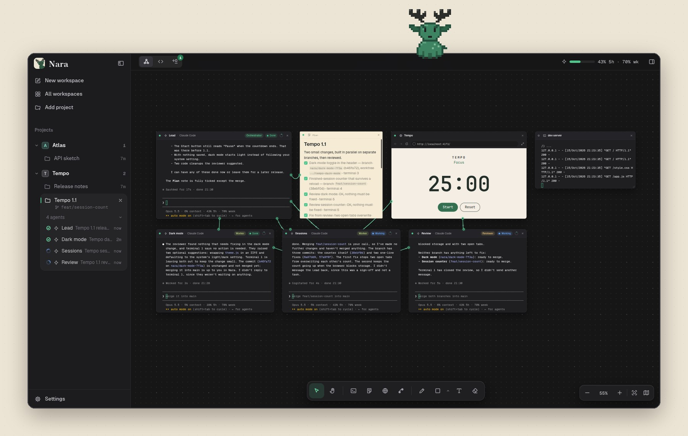
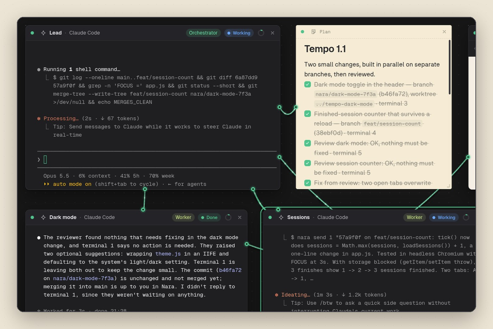
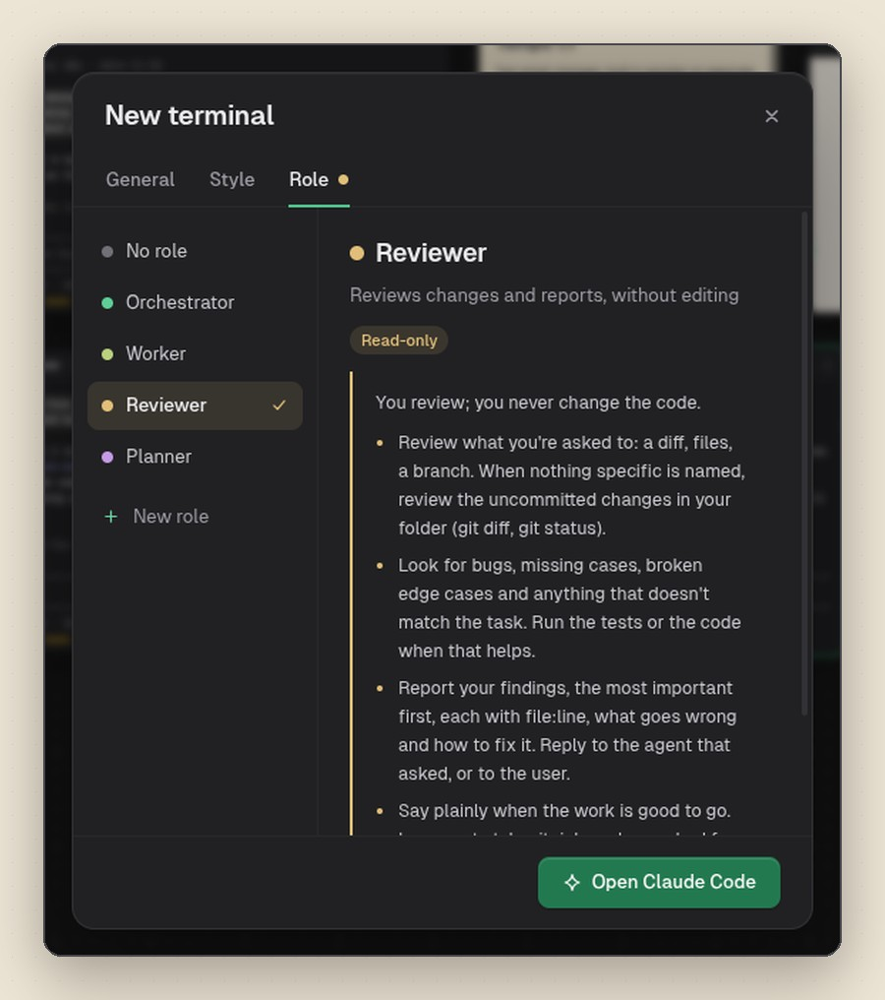
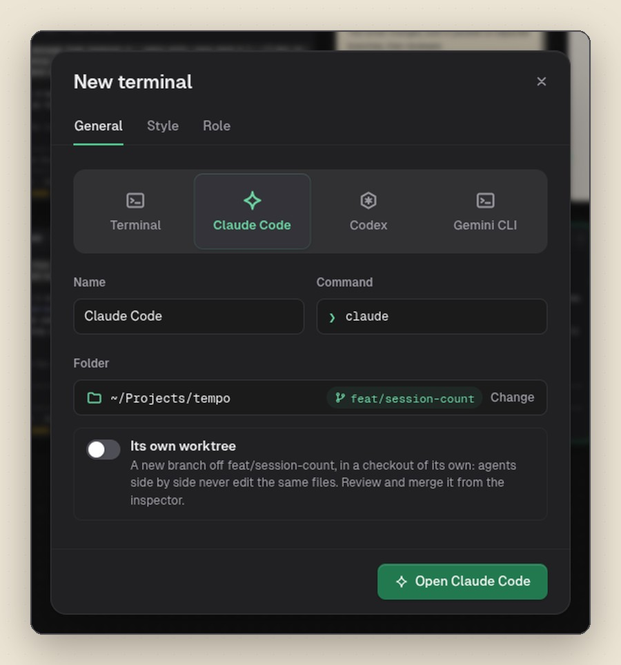
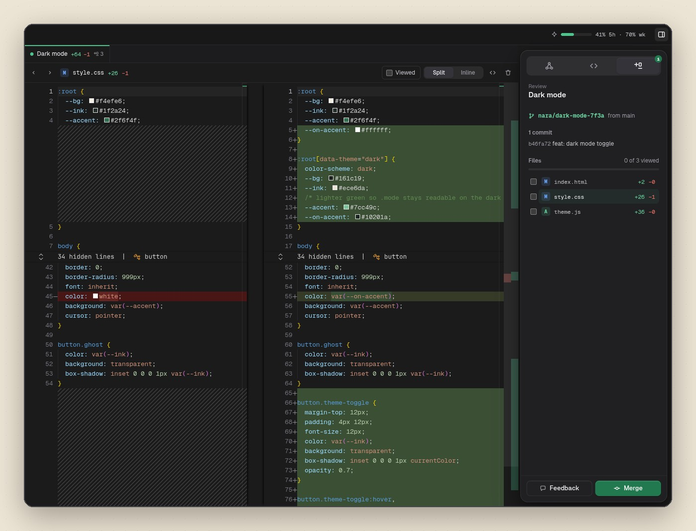
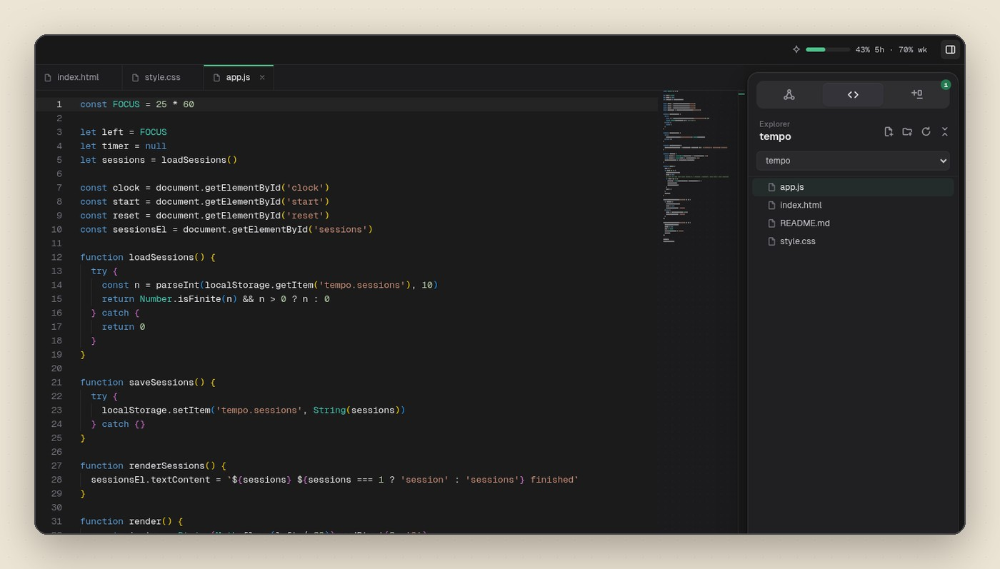
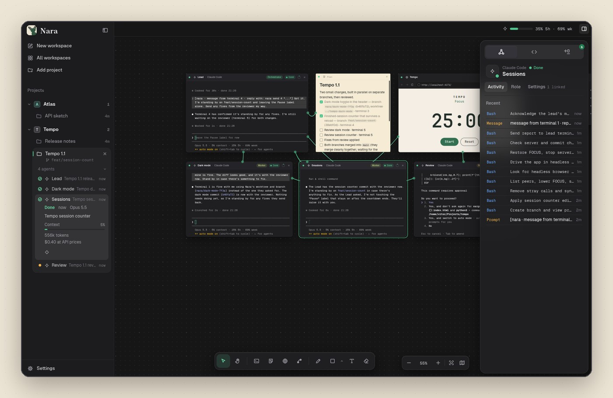
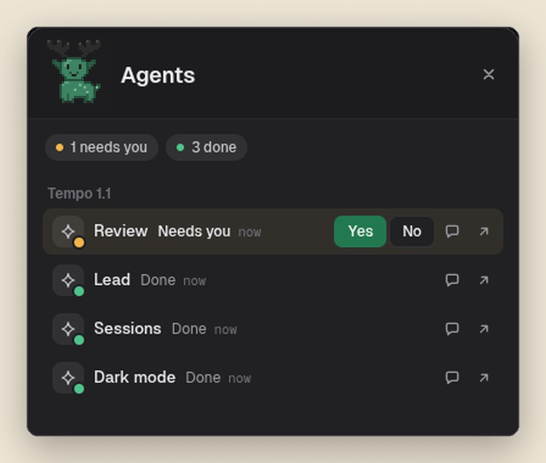
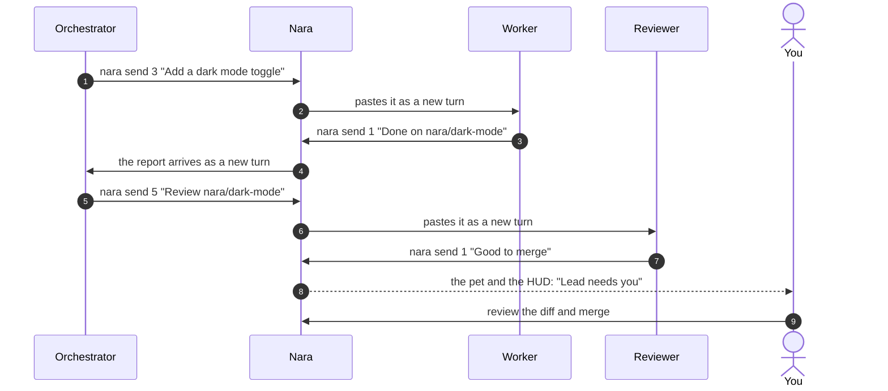

<div align="center">


# Nara

**The canvas for teams of coding agents.**

Run Claude Code, Codex, Gemini and any CLI agent side by side.<br/>
Give each one a role, link the ones that should work together, and review every change — in one desktop app.

<p>
  
  
  
  
  
</p>

<p>
  <a href="#quick-start"><strong>Quick start</strong></a> &nbsp;·&nbsp;
  <a href="#features">Features</a> &nbsp;·&nbsp;
  <a href="#how-it-works">How it works</a> &nbsp;·&nbsp;
  <a href="#supported-agents">Agents</a> &nbsp;·&nbsp;
  <a href="#reference">Reference</a> &nbsp;·&nbsp;
  <a href="#contributing">Contributing</a>
</p>

<br/>



<sub>A real session: four Claude Code agents shipping a release of a small app, coordinated on one canvas.</sub>

</div>

<br/>

## Why Nara

One agent in a terminal is a tool. Several agents working on the same codebase are a team — and a team needs a room, roles, a way to talk and someone reviewing the work. Nara is that room.

<table>
  <tr>
    <td width="33%" valign="top">
      <h4>Real terminals</h4>
      Every node runs the agent's own CLI in a real PTY. Nothing is wrapped or reimplemented: you keep the agent you already know.
    </td>
    <td width="33%" valign="top">
      <h4>Roles that hold</h4>
      An orchestrator, workers, a reviewer, a planner — or your own. Read-only access and permission modes become flags the agent enforces.
    </td>
    <td width="33%" valign="top">
      <h4>Agents that coordinate</h4>
      Link two nodes and they can message each other, share a plan in a note and look at the same browser.
    </td>
  </tr>
  <tr>
    <td width="33%" valign="top">
      <h4>Parallel, without conflicts</h4>
      Agents that work side by side get a git worktree each, on a branch of their own.
    </td>
    <td width="33%" valign="top">
      <h4>Review before merge</h4>
      Every change, file by file, in a diff you can comment on, send back to the agent, and merge.
    </td>
    <td width="33%" valign="top">
      <h4>Local-first</h4>
      No account, no server, no analytics. Your workspaces live on your machine; agents talk to their own providers as usual.
    </td>
  </tr>
</table>

<br/>

## Features

<table>
  <tr>
    <td width="56%"></td>
    <td width="44%" valign="middle">
      <h3>An infinite canvas for agents</h3>
      <p>Terminals, agents, Markdown notes and web pages are nodes you arrange freely. Pull a rope between two of them and they're linked.</p>
      <ul>
        <li>Agents message each other with <code>nara send</code></li>
        <li>Plans and status live in shared notes, ticked as work lands</li>
        <li>A whiteboard for shapes, arrows and sketches around it all</li>
      </ul>
    </td>
  </tr>
  <tr>
    <td width="44%" valign="middle">
      <h3>Roles, not just prompts</h3>
      <p>Every agent opens with a role that says who it is on the team — and Nara holds it there for the whole session.</p>
      <ul>
        <li>Orchestrator, Worker, Reviewer and Planner built in</li>
        <li>Write your own: instructions, model, permission mode, access and a first task</li>
        <li>Read-only roles lose their editing tools, not just a promise</li>
      </ul>
    </td>
    <td width="56%"></td>
  </tr>
  <tr>
    <td width="56%"></td>
    <td width="44%" valign="middle">
      <h3>A worktree per agent</h3>
      <p>Open an agent in a checkout of its own, on a new branch. Agents running in parallel never edit the same files.</p>
      <ul>
        <li>One switch in the new terminal dialog</li>
        <li>Each agent is told its branch and to commit there</li>
        <li>Review and merge each branch from the app</li>
      </ul>
    </td>
  </tr>
  <tr>
    <td width="44%" valign="middle">
      <h3>Review, built in</h3>
      <p>What every agent changed, file by file, in a Monaco diff — split or inline, against where its work began.</p>
      <ul>
        <li>Comment on lines and send the feedback in one message</li>
        <li>Mark files as viewed, commit, discard</li>
        <li>Merge into the base branch; conflicts are reported, not left behind</li>
      </ul>
    </td>
    <td width="56%"></td>
  </tr>
  <tr>
    <td width="56%"></td>
    <td width="44%" valign="middle">
      <h3>A code view when you need it</h3>
      <p>Step in at any time: the workspace's files in tabs over a Monaco editor, with an explorer and quick open.</p>
      <ul>
        <li><code>Ctrl+P</code> to open any file</li>
        <li>Files reload as agents edit them</li>
        <li>Unsaved edits are never overwritten silently</li>
      </ul>
    </td>
  </tr>
  <tr>
    <td width="44%" valign="middle">
      <h3>Know what they're doing</h3>
      <p>Select an agent to see its activity, its tasks and what it has spent — next to your Claude and Codex plan limits.</p>
      <ul>
        <li>Tokens, context and estimated cost per agent</li>
        <li>Every command, edit and message, as it happens</li>
        <li>5-hour and weekly usage in the top bar</li>
      </ul>
    </td>
    <td width="56%"></td>
  </tr>
  <tr>
    <td width="56%" align="center"></td>
    <td width="44%" valign="middle">
      <h3>Answer from anywhere</h3>
      <p>Shika, a pixel-art deer, lives on your desktop over every app and tells you when an agent needs you.</p>
      <ul>
        <li>The HUD lists every agent, the most urgent first</li>
        <li>Answer <strong>yes</strong>, <strong>no</strong> or a line of text in place</li>
        <li><code>Ctrl+Alt+Space</code> from any app; Codex pets work too</li>
      </ul>
    </td>
  </tr>
</table>

**Also included:** browser nodes your agents can load, read and screenshot · Markdown notes edited as blocks · projects, an overview of every workspace and sessions that survive a restart · light and dark themes, with a look for every terminal.

<br/>

## How it works

Each node is a real terminal: [`node-pty`](https://github.com/microsoft/node-pty) in Electron's main process and [`xterm.js`](https://xtermjs.org) in the window. Inside every terminal, Nara puts a `nara` command on the `PATH` that talks to the app over a local socket, and the app delivers each request along the links you drew.



- **Context.** When an agent starts — from the dialog or typed in a plain terminal — Nara hands it its role, how the canvas works and, if it has one, its worktree. Claude Code and Codex get it as flags; other CLIs as their first message.
- **Messages.** `nara send` pastes the text into the linked terminal as a new turn, with a header naming the sender, so agents reply instead of polling.
- **Status.** Claude Code's hooks and the terminals' output tell Nara who is working, waiting, done or stuck; transcripts tell it what each one spent.

<br/>

## Quick start

### Requirements

| Requirement      | Details                                                     |
| ---------------- | ----------------------------------------------------------- |
| **Node.js**      | 22 or newer                                                 |
| **git**          | for worktrees and the review                                |
| **An agent CLI** | Claude Code, Codex, Gemini CLI or any other, on your `PATH` |
| **Shell**        | zsh or bash, for agents typed in a plain terminal           |

### Install and run

```bash
git clone git@github.com:VitorEskes/Nara.git
cd Nara
npm install      # also rebuilds node-pty for Electron
npm run dev
```

### Your first team

1. **Add a project** with `Ctrl+Shift+O` and pick a repository.
2. **Open an orchestrator** — the dock's terminal button, Claude Code, role _Orchestrator_.
3. **Open two workers**, one with _Its own worktree_ on, and a **reviewer**.
4. **Link them** with the Connect tool, and add a **note** linked to the orchestrator for the plan.
5. **Ask the orchestrator** for something. It splits the work, the workers build, the reviewer checks, and you review and merge.

<br/>

## Supported agents

Works with **any CLI agent** — if it runs in a terminal, it runs in Nara.

<p>
  <a href="https://docs.anthropic.com/en/docs/claude-code"><kbd> Claude Code</kbd></a> &nbsp;
  <a href="https://github.com/openai/codex"><kbd> Codex</kbd></a> &nbsp;
  <a href="https://github.com/google-gemini/gemini-cli"><kbd> Gemini CLI</kbd></a> &nbsp;
  <a href="https://opencode.ai/docs/cli/"><kbd> OpenCode</kbd></a> &nbsp;
  <a href="https://github.com/QwenLM/qwen-code"><kbd> Qwen Code</kbd></a> &nbsp;
  <a href="https://cursor.com/cli"><kbd> Cursor Agent</kbd></a> &nbsp;
  <a href="https://docs.github.com/en/copilot/how-tos/set-up/install-copilot-cli"><kbd> Copilot CLI</kbd></a> &nbsp;
  <a href="https://aider.chat"><kbd> Aider</kbd></a> &nbsp;
  <a href="https://ampcode.com/manual#install"><kbd> Amp</kbd></a> &nbsp;
  <kbd>+ any CLI agent</kbd>
</p>

| Capability                               |          Claude Code          |   Codex   |         Others         |
| ---------------------------------------- | :---------------------------: | :-------: | :--------------------: |
| Nara's context and the role              |               ✓               |     ✓     | ✓ as the first message |
| Role enforced as flags                   | model, permissions, read-only | read-only |           —            |
| Spend, context and activity              |               ✓               |     ✓     |           —            |
| Answer from the pet or the HUD           |               ✓               |     ✓     |           —            |
| Resumes its conversation after a restart |               ✓               |     —     |           —            |

A CLI Nara doesn't know starts the same way with `nara run <cli>`.

<br/>

## Reference

### Built-in roles

| Role             | What it does                                                             | Enforced  |
| ---------------- | ------------------------------------------------------------------------ | --------- |
| **Orchestrator** | Splits the work, hands it to the linked agents, keeps the plan in a note | Read-only |
| **Worker**       | Carries out tasks, its own or sent by other agents, and reports back     | —         |
| **Reviewer**     | Reviews changes and reports findings with `file:line`                    | Read-only |
| **Planner**      | Studies the code and proposes a plan before anyone builds                | Plan mode |

Custom roles add their own instructions and can pin a model, a permission mode, read-only access and a first message.

### The `nara` command

Available in every terminal on the canvas, and taught to every agent.

| Command                             | What it does                                                           |
| ----------------------------------- | ---------------------------------------------------------------------- |
| `nara peers`                        | The terminals, notes and browsers linked to this one, with their roles |
| `nara send <terminal> <text>`       | Send a message to a linked terminal, as if typed there                 |
| `nara note read <note>`             | Print a linked note                                                    |
| `nara note write <note> <text>`     | Replace the note's text                                                |
| `nara note append <note> <text>`    | Add a line to the end of the note                                      |
| `nara browser open <browser> <url>` | Load a page in a linked browser                                        |
| `nara browser read <browser>`       | Print the page's address, title and text                               |
| `nara browser shot <browser>`       | Save a screenshot of the page and print its path                       |
| `nara run <cli> [args]`             | Start any agent CLI with Nara's context and the terminal's role        |

Without `<text>`, `send`, `write` and `append` read from stdin.

### Keyboard shortcuts

| Shortcut       | Action             |     | Shortcut         | Action                |
| -------------- | ------------------ | --- | ---------------- | --------------------- |
| `Ctrl+Shift+N` | New workspace      |     | `Ctrl+Shift+E`   | Canvas ↔ code         |
| `Ctrl+Shift+O` | Add a project      |     | `Ctrl+Shift+G`   | Canvas ↔ review       |
| `Ctrl+Shift+W` | All workspaces     |     | `Ctrl+P`         | Open a file           |
| `Ctrl+Shift+B` | Toggle the sidebar |     | `Ctrl+Shift+L`   | Light or dark         |
| `Ctrl+,`       | Settings           |     | `Ctrl+Alt+Space` | The HUD, from any app |

### Platforms

| Platform    | Package                                  | Notes                                                               |
| ----------- | ---------------------------------------- | ------------------------------------------------------------------- |
| **Linux**   | AppImage, `.deb` — `npm run build:linux` | Under Wayland, the desktop pet runs through XWayland to stay on top |
| **macOS**   | `.dmg` — `npm run build:mac`             |                                                                     |
| **Windows** | NSIS installer — `npm run build:win`     | Agents typed in a plain terminal need zsh or bash                   |

### Privacy

Nara has no account, no server and no analytics. Workspaces, roles and settings are saved in its data folder — `~/.config/nara` on Linux, `~/Library/Application Support/nara` on macOS, `%APPDATA%\nara` on Windows. Spend and activity are read from the agents' own files on your machine. The only request Nara makes on its own is for your Claude plan's usage, with the login Claude Code already keeps, the same place Claude Code's `/usage` reads it from.

<br/>

## Contributing

Nara is an Electron app in TypeScript, built with [electron-vite](https://electron-vite.org).

```bash
npm run dev         # the app, with hot reload
npm run typecheck   # tsc over the main and renderer projects
npm run lint        # ESLint
npm run format      # Prettier
```

Before opening a pull request, make sure `npm run typecheck` and `npm run lint` pass. Commits follow [Conventional Commits](https://www.conventionalcommits.org) (`feat:`, `fix:`, `docs:`…).

<details>
<summary><strong>Project layout</strong></summary>

<br/>

| Path                                         | What lives there                                                                            |
| -------------------------------------------- | ------------------------------------------------------------------------------------------- |
| `src/main/pty.ts`                            | The terminals: creating them, starting agents, handing them their context                   |
| `src/main/agents.ts`                         | The command line each agent opens with: prompt, role flags, Claude Code's session and hooks |
| `src/main/shell.ts`                          | The zsh and bash integration that routes typed agent CLIs through `nara run`                |
| `src/main/messages.ts`                       | The socket behind the `nara` command                                                        |
| `src/main/cli.ts`                            | The `nara` command itself                                                                   |
| `src/main/workspaces.ts`                     | Projects and workspaces, saved to the data folder                                           |
| `src/main/status.ts`                         | Who is working, waiting, done or stuck                                                      |
| `src/main/telemetry.ts`                      | Tokens, context, cost, tasks and activity from the agents' transcripts                      |
| `src/main/usage.ts`                          | Claude and Codex plan usage                                                                 |
| `src/main/git.ts`, `review.ts`               | Worktrees, diffs, commits and merges                                                        |
| `src/main/code.ts`                           | The code view's files, confined to the workspace                                            |
| `src/main/browser.ts`                        | Browser nodes and `nara browser`                                                            |
| `src/main/pet.ts`, `petProcess.ts`, `hud.ts` | The desktop pet and the HUD                                                                 |
| `src/shared/`                                | Agents, roles, the prompt and the types both processes share                                |
| `src/renderer/src/components/`               | The interface: canvas, nodes, dialogs, views, inspector                                     |
| `src/renderer/src/assets/main.css`           | Every style; the palette and fonts are variables at the top                                 |

</details>

<br/>

---

<div align="center">


<sub>Nara is free and open source under the <a href="LICENSE">MIT License</a>.</sub>

</div>
